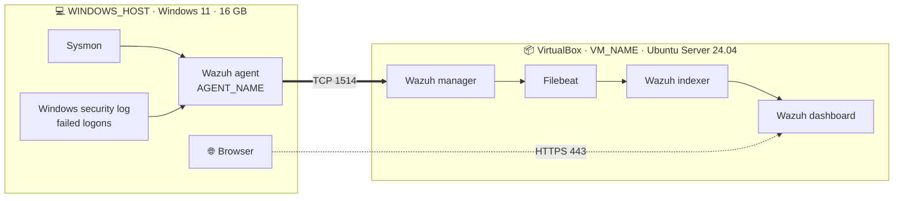

# Wazuh Home Lab: One Laptop, Zero Budget

*A working SIEM on a 16 GB Windows laptop, built by someone who hit every wall so you can skip most of them.*

   

By **custome npc**

**BIOS ➜ VirtualBox ➜ Ubuntu VM ➜ SSH ➜ Wazuh ➜ Agent ➜ Sysmon ➜ Dashboard**

---

## Legend

I never put real values in this repo. Wherever you see one of these, swap in your own.

| Placeholder | Means |
|---|---|
| `<WAZUH_SERVER_IP>` | The IP your Wazuh VM gets on your network |
| `<UBUNTU_USER>` | The username you create during the Ubuntu install |
| `<ADMIN_PASSWORD>` | The dashboard `admin` password the installer prints |
| `<AGENT_NAME>` | The name you give the Windows agent |
| `<VM_NAME>` | The VirtualBox VM name and Ubuntu server name |
| `<WINDOWS_HOST>` | Your Windows 11 laptop |

Callouts in this guide:

> ⚠️ Warning, or a command that deletes something.

> 💡 A shortcut, or something that looks broken but isn't.

> ✅ How to check that a step worked.

---

## Architecture



One laptop. The Wazuh server lives in a VM. The Windows host is the machine being watched. Both sit on the same Wi-Fi subnet through a bridged adapter.

### Ports

| Port | Protocol | Direction | What it's for |
|---|---|---|---|
| 22 | TCP | Windows ➜ VM | SSH, so copy-paste works |
| 443 | TCP | Browser ➜ VM | Dashboard |
| 1514 | **TCP** | Agent ➜ VM | Agent events. I run it on TCP. UDP bit me, see Phase 9 |
| 1515 | TCP | Agent ➜ VM | The agent asking the manager for its key |

---

## Before you start

- [ ] Windows 11 laptop with 16 GB RAM and about 60 GB of free disk
- [ ] Administrator rights on Windows
- [ ] Access to BIOS (on my ASUS TUF A15 it's F2 at boot)
- [ ] A Wi-Fi or LAN network that hands out DHCP addresses
- [ ] An afternoon. The Wazuh install alone took me about 70 minutes

Tested with:

| Piece | Version |
|---|---|
| Wazuh | 4.14.9 |
| Ubuntu Server | 24.04.5 LTS (AMD64) |
| Host | Windows 11, Ryzen 7 7435HS, RTX 3050 4 GB |

---

## Table of contents

- [Phase 0: Prep the host](#phase-0-prep-the-host)
- [Phase 1: Create the VM](#phase-1-create-the-vm)
- [Phase 2: Install Ubuntu Server](#phase-2-install-ubuntu-server)
- [Phase 3: First boot, SSH and disk](#phase-3-first-boot-ssh-and-disk)
- [Phase 4: Install Wazuh](#phase-4-install-wazuh)
- [Phase 5: Deploy the Windows agent](#phase-5-deploy-the-windows-agent)
- [Phase 6: Add Sysmon](#phase-6-add-sysmon)
- [Phase 7: See your events](#phase-7-see-your-events)
- [Phase 8: Fix the lag](#phase-8-fix-the-lag)
- [Phase 9: Agent shows Never connected after a break](#phase-9-agent-shows-never-connected-after-a-break)
- [Troubleshooting index](#troubleshooting-index)
- [What I will add later](#what-i-will-add-later)

---

## Phase 0: Prep the host

| ⏱ Time | 📋 You need | 🏁 Done looks like |
|---|---|---|
| A few minutes of clicking, plus however long a 3.8 GB download takes you | Admin on Windows, BIOS access | SVM on, VirtualBox and Extension Pack installed, Ubuntu ISO on disk |

### Goal
Get the laptop ready to run a VM.

### Steps
1. Reboot and press **F2** to enter BIOS.
2. Turn on **SVM Mode**. That's AMD's name for virtualization. Save and exit.
3. Install VirtualBox, then the Extension Pack.
4. Download the **Ubuntu Server 24.04.5 LTS AMD64** ISO directly from [releases.ubuntu.com/24.04](https://releases.ubuntu.com/24.04/). The file you want is named like `ubuntu-24.04.5-live-server-amd64.iso`.

> ⚠️ My first "ISO" was a 305 KB `.torrent` file. That is not the ISO. The real one is about 3.8 GB.

[screenshot: BIOS screen with SVM Mode enabled — redact: nothing]

### Verify
> ✅ The ISO is about 3.8 GB in File Explorer.

### If it fails
A tiny file means you grabbed the torrent. Go back to the direct link above.

---

## Phase 1: Create the VM

| ⏱ Time | 📋 You need | 🏁 Done looks like |
|---|---|---|
| A few minutes. I didn't time it | VirtualBox, the ISO | A VM named `<VM_NAME>` with 8 GB RAM, 4 CPUs, a 60 GB disk and a bridged adapter |

### Goal
Create an empty VM with enough room for Wazuh.

| Resource | Host (`<WINDOWS_HOST>`) | VM (`<VM_NAME>`) |
|---|---|---|
| RAM | 16 GB | 8192 MB |
| CPU | Ryzen 7 7435HS | 4 CPUs |
| Disk | n/a | 60 GB, dynamically allocated VDI |
| Network | Wi-Fi | **Bridged Adapter** on the Wi-Fi NIC |

### Steps
1. New VM. Name it `<VM_NAME>`. Type **Linux**, version **Ubuntu (64-bit)**. Point it at the ISO.
2. Choose **skip unattended guest OS install**.
3. Set 8192 MB RAM and 4 CPUs.
4. Create a 60 GB dynamically allocated VDI.
5. Open Settings ➜ Network. Set Adapter 1 to **Bridged Adapter** and pick your Wi-Fi card.

> 💡 The wizard asking you to skip unattended install looks like a warning. It isn't. It's the correct choice. It just means you install Ubuntu by hand.

[screenshot: VM Network settings showing Bridged Adapter — redact: Wi-Fi adapter name if it shows your router model]

### Verify
> ✅ The VM appears in VirtualBox with the settings from the table.

### If it fails
I started with NAT plus Host-Only. Host-Only never worked. On the Windows side, this showed no `192.168.56.1` VirtualBox Host-Only adapter:

```powershell
ipconfig
```

Inside Ubuntu, `enp0s8` stayed `state DOWN` with no IP. I didn't dig into why. I switched to a single Bridged Adapter on the Wi-Fi NIC and it worked right away, the same as a Kali VM I'd used earlier. Skip straight to bridged.

---

## Phase 2: Install Ubuntu Server

| ⏱ Time | 📋 You need | 🏁 Done looks like |
|---|---|---|
| A short install. I didn't time it | The VM from Phase 1 | Ubuntu reboots to a login prompt |

### Goal
Install Ubuntu Server by hand with SSH switched on.

### Steps
1. Start the VM and boot the ISO.
2. Language and keyboard: defaults.
3. Network: leave DHCP on the bridged adapter.
4. Proxy: leave blank and click Done. You can set one later under `/etc/apt/apt.conf.d/` if you ever need it.
5. Storage: use the entire disk, default LVM.
6. Profile: pick a full name, set the server name to `<VM_NAME>`, set the username to `<UBUNTU_USER>`, and use a strong password.
7. Tick **Install OpenSSH server**. Do not import an SSH key. Password login is fine for a lab.
8. Featured Server Snaps: select nothing and click Done.
9. Let it install, then reboot.

[screenshot: Ubuntu profile setup screen — redact: real name, username]

### Verify
> ✅ You land on a text login prompt after the reboot.

### If it fails
Nothing broke for me here.

---

## Phase 3: First boot, SSH and disk

| ⏱ Time | 📋 You need | 🏁 Done looks like |
|---|---|---|
| A few minutes | Ubuntu installed | You're logged in over SSH from Windows and `df -h /` shows about 57 GB |

### Goal
Find the VM's IP, claim the whole disk, and move to SSH.

### Steps
1. Log in at the VirtualBox console.

> 💡 Copy-paste does not work in the VirtualBox console. That's the whole reason we move to SSH in a minute. Type the next two commands by hand.

2. Find your IP:

```bash
ip a
```

On bridged networking you should see `enp0s3` up with a DHCP address. That address is your `<WAZUH_SERVER_IP>`.

3. Ubuntu only uses part of your disk by default. Expand it:

```bash
sudo lvextend -r -l +100%FREE /dev/ubuntu-vg/ubuntu-lv
```

4. Check the size:

```bash
df -h /
```

5. From PowerShell on Windows, connect:

```powershell
ssh <UBUNTU_USER>@<WAZUH_SERVER_IP>
```

6. Type `yes` to accept the ED25519 fingerprint. From here on, everything runs over SSH.

### Verify
> ✅ `df -h /` shows about 57 GB, and you have an SSH prompt where paste works.

### If it fails
If `enp0s8` shows up as `state DOWN`, that's a leftover Host-Only adapter. Go back to Phase 1 and switch to a single Bridged Adapter. After I switched, only `enp0s3` existed and it had an IP.

---

## Phase 4: Install Wazuh

| ⏱ Time | 📋 You need | 🏁 Done looks like |
|---|---|---|
| **About 70 minutes** | VM with internet, SSH session | "Installation finished", three services `active`, dashboard login works |

### Goal
Run the all-in-one installer: indexer, manager, Filebeat and dashboard on one box.

### Steps
1. Start the installer:

```bash
curl -sO https://packages.wazuh.com/4.14/wazuh-install.sh && sudo bash ./wazuh-install.sh -a
```

The installer prints `Wazuh version: 4.14.9` at the start. Here is what my run looked like:

| Stage | Started | Finished | Took | |
|---|---|---|---|---|
| Indexer | 10:22 | 10:58 | ~36 min | ██████████████████ |
| Manager | 10:58 | 11:13 | ~15 min | ████████ |
| Filebeat | 11:13 | 11:15 | ~2 min | █ |
| Dashboard | 11:15 | 11:33 | ~18 min | █████████ |

The install looked frozen. It sat on "Starting Wazuh indexer installation" for 36 minutes. I almost killed it. Don't. Open a second SSH window and run this. If new timestamped lines keep appearing, it's working, just slow.

```bash
sudo tail -f /var/log/wazuh-install.log
```

2. When it finishes, it prints the admin username and password.

> ⚠️ Save that password right away. I did. If you lose it, run this in the folder where you ran the installer:

```bash
sudo tar -O -xvf wazuh-install-files.tar wazuh-install-files/wazuh-passwords.txt
```

3. Stop surprise upgrades by disabling the Wazuh apt repo:

```bash
sudo sed -i "s/^deb/#deb/" /etc/apt/sources.list.d/wazuh.list && sudo apt update
```

4. Check the services:

```bash
sudo systemctl is-active wazuh-manager wazuh-indexer wazuh-dashboard
```

5. In your Windows browser go to `https://<WAZUH_SERVER_IP>`. Accept the certificate warning. Log in as `admin` with `<ADMIN_PASSWORD>`.

[screenshot: Wazuh dashboard login page — redact: the IP in the address bar]

### Verify
> ✅ All three services print `active`, and you're inside the dashboard.

### If it fails
- **Looks frozen:** it's not. Use the `tail -f` command above.
- **Lost the password:** use the `tar` command from step 2.

---

## Phase 5: Deploy the Windows agent

| ⏱ Time | 📋 You need | 🏁 Done looks like |
|---|---|---|
| About a minute for the agent to show up | Dashboard access, Admin PowerShell | `<AGENT_NAME>` shows **Active** |

### Goal
Install the Wazuh agent on `<WINDOWS_HOST>` and connect it to the server.

### Steps
1. In the dashboard open **Agents management ➜ Summary ➜ Deploy new agent**. On the page it may be labelled Endpoints Summary.
2. Choose **Windows**.
3. Enter `<WAZUH_SERVER_IP>` as the server address.
4. Name the agent `<AGENT_NAME>`.
5. Copy the PowerShell command the wizard generates and run it in **PowerShell as Administrator**.
6. Start the service:

```powershell
NET START WazuhSvc
```

[screenshot: Deploy new agent wizard with generated command — redact: server IP, any key or token in the command]

### Verify
> ✅ Within about a minute `<AGENT_NAME>` shows **Active** in Endpoints Summary.

### If it fails
It didn't fail for me the first time. It did later, after a few days off. See Phase 9.

---

## Phase 6: Add Sysmon

| ⏱ Time | 📋 You need | 🏁 Done looks like |
|---|---|---|
| A few minutes | Active agent, Admin PowerShell | Sysmon installed and the agent collecting its log |

### Goal
Get detailed process and network telemetry out of Windows and into Wazuh.

### Steps
1. In **Administrator PowerShell**, pull the Sysmon zip and the SwiftOnSecurity config into `$env:tmp`:

```powershell
Invoke-WebRequest -Uri https://download.sysinternals.com/files/Sysmon.zip -OutFile "$env:tmp\Sysmon.zip"
Expand-Archive "$env:tmp\Sysmon.zip" "$env:tmp\Sysmon" -Force
Invoke-WebRequest -Uri https://raw.githubusercontent.com/SwiftOnSecurity/sysmon-config/master/sysmonconfig-export.xml -OutFile "$env:tmp\sysmonconfig.xml"
```

2. Install it with the config:

```powershell
& "$env:tmp\Sysmon\Sysmon64.exe" -accepteula -i "$env:tmp\sysmonconfig.xml"
```

My first try failed with a PowerShell parse error. I left off the opening quote and the `&`. The command has to start with `& "`.

3. Open `C:\Program Files (x86)\ossec-agent\ossec.conf` in an editor **run as Administrator**.
4. Add this inside `<ossec_config>`:

```xml
<localfile>
  <location>Microsoft-Windows-Sysmon/Operational</location>
  <log_format>eventchannel</log_format>
</localfile>
```

5. Restart the agent:

```powershell
Restart-Service WazuhSvc
```

### Verify
> ✅ Sysmon events show up in the dashboard. That's Phase 7.

### If it fails
A parse error means the quote at the start of the command is missing. Use the `& "` form above.

---

## Phase 7: See your events

| ⏱ Time | 📋 You need | 🏁 Done looks like |
|---|---|---|
| A few minutes | Sysmon collecting, agent Active | Sysmon events and a failed-logon alert (rule 60122, level 5) visible |

### Goal
Prove the whole pipeline works, from Windows to the dashboard.

### Steps
1. Open the **Events** view in the dashboard.
2. Search for Sysmon events with this DQL query. Note there is no space after the colon:

```text
data.win.system.providerName:Microsoft-Windows-Sysmon
```

3. Look for failed logons:

```text
rule.id:60122
```

Rule 60122 fired for me at level 5.

> 💡 If you don't see a failed logon yet, mistype your Windows password once at the sign-in screen, then check again.

[screenshot: Events view showing Sysmon events — redact: agent name, hostnames, usernames]

### Verify
> ✅ You can see both Sysmon events and a rule 60122 failed-logon event.

### If it fails
**A "you may be using Lucene syntax while DQL is selected" warning.** The search bar was in DQL mode. Either switch the query-language dropdown to Lucene, or keep DQL and write the query with no space after the colon. Don't mix the two.

**The Events view went blank after I switched to Lucene.** That was a dashboard UI bug plus the time range. I switched back to DQL and widened the time range from the default 15 minutes to **Today**. The data was never lost.

---

## Phase 8: Fix the lag

| ⏱ Time | 📋 You need | 🏁 Done looks like |
|---|---|---|
| A few minutes | SSH session | Indexer restarted with a 2 GB heap, VM and dashboard feel normal |

### Goal
Stop the VM and dashboard from crawling.

The indexer's default JVM heap is too greedy for an 8 GB VM. I capped it at 2 GB.

### Steps
1. Open the file:

```bash
sudo nano /etc/wazuh-indexer/jvm.options
```

2. Find the existing `-Xms` and `-Xmx` lines and set both to this:

```text
-Xms2g
-Xmx2g
```

3. Restart the indexer:

```bash
sudo systemctl restart wazuh-indexer
```

> ⚠️ Keep both values the same. Mismatched `-Xms` and `-Xmx` values make the heap resize on the fly.

### Verify
> ✅ The indexer comes back `active` and the dashboard stops stuttering.

```bash
sudo systemctl is-active wazuh-indexer
```

### If it fails
Give the indexer a minute or two to come back before judging the dashboard.

---

## Phase 9: Agent shows Never connected after a break

| ⏱ Time | 📋 You need | 🏁 Done looks like |
|---|---|---|
| About 10 minutes the first time | Admin PowerShell, SSH session | Agent **Active** over **TCP** |

### Goal
Fix an agent that went to "Never connected" after I shut everything down for a few days.

### Steps
This was two separate problems stacked on top of each other.

**Problem A: stale key.** The manager timed the agent out. The agent's local key no longer matched, so it couldn't re-enroll. The agent log showed `Duplicate agent name: <AGENT_NAME>`. To read it:

```powershell
Get-Content "C:\Program Files (x86)\ossec-agent\ossec.log" -Tail 30
```

> ⚠️ This deletes the agent's local key. Do these in this order.

```powershell
Stop-Service WazuhSvc
Remove-Item "C:\Program Files (x86)\ossec-agent\client.keys" -Force
Start-Service WazuhSvc
```

The log should now show `Requesting a key from server` and then `Valid key received`. On the server, confirm the agent is listed with a new ID:

```bash
sudo /var/ossec/bin/manage_agents -l
```

**Problem B: still Never connected.** Even after re-enrolling, the agent stayed Never connected. The port test said everything was fine:

```powershell
Test-NetConnection <WAZUH_SERVER_IP> -Port 1514
```

> 💡 `True` only means something answered on that port. It doesn't mean the agent and manager agree on the protocol.

The agent was set to **UDP** and the manager only listens on **TCP**. I confirmed it on the server. This found nothing:

```bash
sudo ss -lnup | grep 1514
```

And this showed `wazuh-remoted` listening on `0.0.0.0:1514`:

```bash
sudo ss -lntp | grep 1514
```

The fix is on the Windows host. In `C:\Program Files (x86)\ossec-agent\ossec.conf`, under `<client><server>`, set the protocol to `tcp`. The protocol line is the only thing I changed. The rest is shown for context:

```xml
<client>
  <server>
    <address><WAZUH_SERVER_IP></address>
    <port>1514</port>
    <protocol>tcp</protocol>
  </server>
</client>
```

Then restart the agent:

```powershell
Restart-Service WazuhSvc
```

### Verify
> ✅ `<AGENT_NAME>` shows **Active** in the dashboard, and `manage_agents -l` lists it.

### If it fails
Run through both problems in order. Problem A without B still leaves the agent disconnected.

### Where I ended up

| Piece | State |
|---|---|
| Agent `<AGENT_NAME>` | Active, TCP 1514 |
| Sysmon events | Showing in the dashboard |
| Failed logons | Showing (rule 60122, level 5) |
| Indexer heap | 2 GB |

---

## Troubleshooting index

| Symptom | Likely cause | Jump to |
|---|---|---|
| "ISO" is only 305 KB | You downloaded the `.torrent` | [Phase 0](#phase-0-prep-the-host) |
| VirtualBox says "skip unattended install" | Expected. You install Ubuntu by hand | [Phase 1](#phase-1-create-the-vm) |
| No `192.168.56.1` adapter, `enp0s8` is DOWN | Host-Only never worked on my machine | [Phase 1](#phase-1-create-the-vm) |
| Can't paste in the VM console | Console limitation, use SSH | [Phase 3](#phase-3-first-boot-ssh-and-disk) |
| Disk shows far less than 60 GB | Default LVM doesn't use the whole disk | [Phase 3](#phase-3-first-boot-ssh-and-disk) |
| Installer looks frozen | The indexer step takes ~36 minutes | [Phase 4](#phase-4-install-wazuh) |
| Lost the admin password | Pull it from `wazuh-install-files.tar` | [Phase 4](#phase-4-install-wazuh) |
| PowerShell parse error installing Sysmon | Missing opening `& "` | [Phase 6](#phase-6-add-sysmon) |
| "Lucene syntax while DQL is selected" | Query language mismatch | [Phase 7](#phase-7-see-your-events) |
| Events view blank | UI bug plus the 15-minute default range | [Phase 7](#phase-7-see-your-events) |
| VM and dashboard laggy | Indexer JVM heap too large for 8 GB | [Phase 8](#phase-8-fix-the-lag) |
| Agent "Never connected", log says Duplicate agent name | Stale local key | [Phase 9](#phase-9-agent-shows-never-connected-after-a-break) |
| Still never connected, port 1514 test is True | Agent on UDP, manager on TCP | [Phase 9](#phase-9-agent-shows-never-connected-after-a-break) |

---

## What I will add later

- Telegram notifications
- Active response blocking
- Network IDS
- Custom automation

---

*Built and broken by custome npc.*
