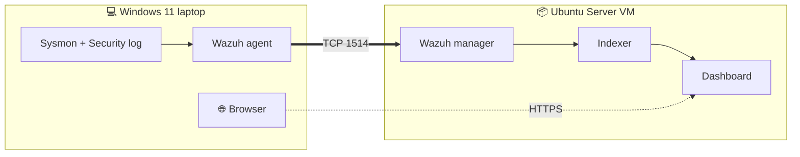

<div align="center">

# Wazuh Home Lab

*A working SIEM on one Windows laptop. No second machine, no budget.*

  

By **custome npc**

**Prep ➜ VM ➜ Ubuntu ➜ Wazuh ➜ Agent ➜ Sysmon ➜ First detection**

I built this on my own laptop and wrote down everything, including what broke. By the end of this page you'll have Wazuh running and catching a failed logon. Errors are in [docs/troubleshooting](docs/troubleshooting/README.md). Bigger builds come later in [docs/roadmap](docs/roadmap/README.md).

---

## How it fits together



The Wazuh server runs in a VM. Your Windows laptop is the machine being watched.

## Placeholders

I never put real values in this repo. Replace these with yours.

| Placeholder | Means |
|---|---|
| `<WAZUH_SERVER_IP>` | IP address of the Wazuh VM |
| `<UBUNTU_USER>` | Username you create in Ubuntu |
| `<ADMIN_PASSWORD>` | Dashboard `admin` password from the installer |
| `<AGENT_NAME>` | Name you give the Windows agent |
| `<VM_NAME>` | VirtualBox VM name and Ubuntu server name |

> ⚠️ Warning, or a command that deletes something.

> 💡 A shortcut or a gotcha.

> ✅ How to check a step worked.

## Before you start

- [ ] Windows 11 laptop, 16 GB RAM, about 60 GB free disk
- [ ] Administrator rights
- [ ] Access to BIOS (F2 on my ASUS TUF A15)
- [ ] Wi-Fi or LAN with DHCP
- [ ] An afternoon. The Wazuh install alone took me about 70 minutes

Tested with Wazuh 4.14.9, Ubuntu Server 24.04.5 LTS, VirtualBox with Extension Pack.

## The path

| # | Step | Time |
|---|---|---|
| 1 | [Prep the laptop](#1-prep-the-laptop) | A few minutes + a 3.8 GB download |
| 2 | [Create the VM](#2-create-the-vm) | A few minutes |
| 3 | [Install Ubuntu](#3-install-ubuntu) | A short install |
| 4 | [Connect over SSH](#4-connect-over-ssh) | A few minutes |
| 5 | [Install Wazuh](#5-install-wazuh) | **About 70 minutes** |
| 6 | [Deploy the agent](#6-deploy-the-agent) | About a minute to show up |
| 7 | [Add Sysmon](#7-add-sysmon) | A few minutes |
| 8 | [First detection](#8-first-detection) | A few minutes |

---

## 1. Prep the laptop

1. Reboot, press **F2**, enable **SVM Mode** (AMD virtualization), save and exit.
2. Install VirtualBox, then the Extension Pack.
3. Download the **Ubuntu Server 24.04.5 LTS AMD64** ISO from [releases.ubuntu.com/24.04](https://releases.ubuntu.com/24.04/).

> ✅ The ISO is about 3.8 GB. If it's 305 KB, you grabbed a torrent file: [fix](docs/troubleshooting/01-iso-is-only-305kb.md).

## 2. Create the VM

| Setting | Value |
|---|---|
| Name | `<VM_NAME>` |
| Type | Linux / Ubuntu (64-bit) |
| RAM | 8192 MB |
| CPUs | 4 |
| Disk | 60 GB, dynamically allocated VDI |
| Network | **Bridged Adapter** on your Wi-Fi card |
| Unattended install | **Skip** |

> 💡 Skipping the unattended install is correct. It means you install Ubuntu yourself.

> 💡 Use Bridged.

## 3. Install Ubuntu

Boot the ISO and go through the installer:

| Screen | What I did |
|---|---|
| Language, keyboard | Defaults |
| Network | Left DHCP on |
| Proxy | Blank, then Done |
| Storage | Entire disk, default LVM |
| Profile | Server name `<VM_NAME>`, user `<UBUNTU_USER>`, password |
| SSH | **Tick Install OpenSSH server**, no key import |
| Server Snaps | Nothing, then Done |

Reboot when it finishes.

## 4. Connect over SSH

At the VM console, find the IP. This is your `<WAZUH_SERVER_IP>`:

```bash
ip a
```

> 💡 Paste doesn't work in the VirtualBox console, so type the next command by hand: [why](docs/troubleshooting/03-cant-paste-in-vm-console.md).

Ubuntu only uses part of the disk by default. Claim all of it:

```bash
sudo lvextend -r -l +100%FREE /dev/ubuntu-vg/ubuntu-lv
```

```bash
df -h /
```

From PowerShell on Windows, connect:

```powershell
ssh <UBUNTU_USER>@<WAZUH_SERVER_IP>
```

Type `yes` to accept the fingerprint. Run everything from here over SSH.

> ✅ `df -h /` shows about 57 GB, and you have an SSH prompt where paste works. If it shows much less: [fix](docs/troubleshooting/04-disk-smaller-than-60gb.md).

## 5. Install Wazuh

```bash
curl -sO https://packages.wazuh.com/4.14/wazuh-install.sh && sudo bash ./wazuh-install.sh -a
```

> ⚠️ The installer prints the `admin` password at the end. Save it now. If you lose it: [recover it](docs/troubleshooting/06-lost-admin-password.md).

Stop surprise upgrades by disabling the Wazuh apt repo:

```bash
sudo sed -i "s/^deb/#deb/" /etc/apt/sources.list.d/wazuh.list && sudo apt update
```

Check the services:

```bash
sudo systemctl is-active wazuh-manager wazuh-indexer wazuh-dashboard
```

In your Windows browser open `https://<WAZUH_SERVER_IP>`, accept the certificate warning, and log in as `admin` with `<ADMIN_PASSWORD>`.

> ✅ All three services print `active` and you're inside the dashboard.

## 6. Deploy the agent

1. In the dashboard open **Agents management ➜ Summary ➜ Deploy new agent**.
2. Pick **Windows**, enter `<WAZUH_SERVER_IP>` as the server address, name it `<AGENT_NAME>`.
3. Run the generated command in **PowerShell as Administrator**.
4. Start the service:

```powershell
NET START WazuhSvc
```

> ✅ `<AGENT_NAME>` shows **Active** within about a minute. If it says Never connected: [fix 1](docs/troubleshooting/11-agent-never-connected-stale-key.md), [fix 2](docs/troubleshooting/12-agent-never-connected-udp-vs-tcp.md).

## 7. Add Sysmon

In **Administrator PowerShell**, download Sysmon and the SwiftOnSecurity config:

```powershell
Invoke-WebRequest -Uri https://download.sysinternals.com/files/Sysmon.zip -OutFile "$env:tmp\Sysmon.zip"
Expand-Archive "$env:tmp\Sysmon.zip" "$env:tmp\Sysmon" -Force
Invoke-WebRequest -Uri https://raw.githubusercontent.com/SwiftOnSecurity/sysmon-config/master/sysmonconfig-export.xml -OutFile "$env:tmp\sysmonconfig.xml"
```

Install it:

```powershell
& "$env:tmp\Sysmon\Sysmon64.exe" -accepteula -i "$env:tmp\sysmonconfig.xml"
```

> 💡 The command has to start with `& "`. A parse error means that part is missing: [fix](docs/troubleshooting/07-sysmon-powershell-parse-error.md).

Open `C:\Program Files (x86)\ossec-agent\ossec.conf` in an editor **run as Administrator**. Inside `<ossec_config>` add:

```xml
<localfile>
  <location>Microsoft-Windows-Sysmon/Operational</location>
  <log_format>eventchannel</log_format>
</localfile>
```

Restart the agent:

```powershell
Restart-Service WazuhSvc
```

## 8. First detection

Time to prove it works.

1. Sign out of Windows. On the sign-in screen, type a **wrong password** once, then sign back in properly.
2. In the dashboard open the **Events** view. If it's empty, widen the time range from 15 minutes to **Today**.
3. Search for the failed logon:

```text
rule.id:60122
```

4. Then search for Sysmon events:

```text
data.win.system.providerName:Microsoft-Windows-Sysmon
```

> ✅ You see Sysmon events and a rule 60122 failed-logon alert. Mine fired at level 5.

[screenshot: Events view showing the failed-logon alert and Sysmon events — redact: agent name, usernames, IP]

> 💡 Search warning about Lucene and DQL: [fix](docs/troubleshooting/08-dql-lucene-warning.md). Blank Events view: [fix](docs/troubleshooting/09-events-view-blank.md). Laggy VM: [fix](docs/troubleshooting/10-vm-and-dashboard-laggy.md).

---

## You're done with the core lab

Wazuh is running, your laptop is enrolled, and it detects what you do to it.

| Next | Where |
|---|---|
| Something broke | [docs/troubleshooting](docs/troubleshooting/README.md) |
| What I build next | [docs/roadmap](docs/roadmap/README.md) |
